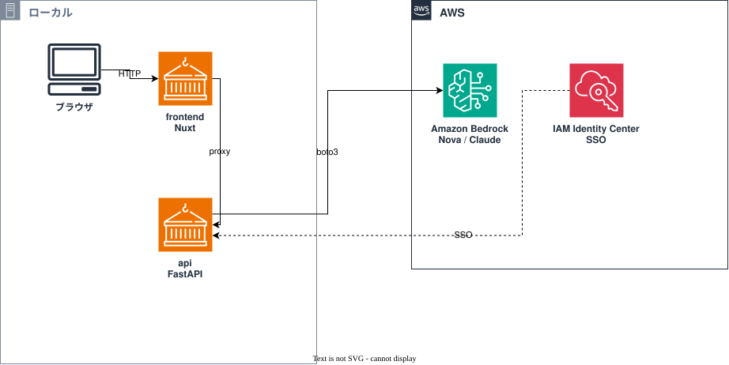

# Amazon Bedrock × Docker × Nuxtで、最小構成のチャットアプリを作ってみた

Amazon Bedrock・Docker・Terraformを学びながら、将来的にRAG（Retrieval-Augmented Generation）システムを作るための土台を、まず手を動かして構築してみました。リポジトリはこちらです。

https://github.com/suupimadev/bedrock-rag-engineering

今回やったのは、ローカルのDocker環境でFastAPIのバックエンドとNuxtのフロントエンドを動かし、バックエンドから実際にAmazon Bedrockを呼び出してAIの応答を返す、というところまでです。RAG本体（Knowledge Basesやベクトル検索、Terraformでのインフラ構築）はまだで、ここから先の宿題にしています。

## 全体の構成

今の時点ではAWS上に何かインフラを構築しているわけではなく（Terraformのリソースはまだ1つも作っていません）、ローカルのDocker環境から、Amazon Bedrockというマネージドサービス1つだけを呼びに行く、というシンプルな構成です。



ポイントは、ブラウザが触れるのは`frontend`コンテナだけで、AWSの認証情報には一切アクセスできないようにしてあることです。`frontend`にはAWS関連の環境変数を1つも渡していませんし、使っている認証情報もIAMユーザーの長期アクセスキーではなく、IAM Identity Center（SSO）から発行した一時的なSTS認証情報です。

## それぞれの技術が何をやっているか

- **Docker / Docker Compose**: `api`と`frontend`をそれぞれ独立したコンテナとして動かし、127.0.0.1限定で公開しています。コンテナ同士はDocker Composeが用意する内部ネットワークで喋ります
- **FastAPI**: バックエンドはPythonで書いています。`GET /health`、`GET /`、`POST /chat`の3本だけのシンプルなAPIで、入力検証はPydanticに任せています
- **Amazon Bedrock**: boto3経由でConverse APIを叩いて、実際のAI応答を受け取るマネージドサービスです。モデルIDはコードに書かず、環境変数で渡すようにしました
- **Nuxt (Vue 3 + TypeScript)**: チャット画面はNuxtのSPAモードで動かしています。バックエンドとの通信はNitroのdevプロキシ機能経由です
- **Vue**: `ref`でリアクティブに状態を持たせつつ、`.vue`の単一ファイルコンポーネントで画面を部品分けしています

バックエンドとフロントエンドで言語を分けているのは、Amazon Bedrockやboto3、LangChainあたりのAI/ML系ツールがPython中心のエコシステムだからです。この先RAGを組んでいくときも、チャンク分割やembedding生成でPythonの資産を使う前提で設計しています。

## どんな順番で作ったか

STEPを4つに分けて、1つずつ進めました。各STEPとも、実装に入る前にDockerやBedrock、IAMまわりの考え方をいったん整理してから手を動かし、終わったらpytest・vitestとDocker上での実際の疎通確認をセットでやる、という進め方を繰り返しています。

### STEP 1: リポジトリとローカル環境の準備

`gh repo create`でリポジトリを作り、`app/`や`docker/`、`tests/`といったディレクトリ構成を整えました。AWS認証情報や`.env`を確実に除外する`.gitignore`も、この段階で用意しています。

### STEP 2: Docker + FastAPI

`python:3.12-slim`ベースの非rootコンテナでFastAPIを動かします。`GET /health`と`GET /`だけのシンプルな状態で、`docker compose up`で`127.0.0.1:8000`に公開するところまで作りました。

### STEP 3: Amazon Bedrock Converse APIとの連携

ようやくBedrockとつながるSTEPです。`boto3.client("bedrock-runtime").converse()`を呼ぶ`POST /chat`を追加しました。AWS CLIで実際に使えるモデルを確認しながら(`aws bedrock list-foundation-models`や`list-inference-profiles`)、モデルIDはコードに固定せず環境変数で渡すようにしています。

### STEP 4: フロントエンドの実装

Vue(Nuxt) + TypeScriptでチャット画面を組み、最終的にAnt Design Vueで見た目を整えました。Nuxtの開発サーバーをそのままコンテナ化し、Nitroのdevプロキシでバックエンドにつないでいます。

## 実装で特に書いておきたいところ

### 入力検証とレスポンスの形

```python
class ChatRequest(BaseModel):
    message: str = Field(min_length=1, max_length=4000)


class ChatResponse(BaseModel):
    reply: str
    model_id: str
    input_tokens: int
    output_tokens: int
```

空文字や極端に長い入力は、ハンドラ側に1行もコードを書かずにPydanticの宣言だけで弾けます。

### Bedrock呼び出しとエラーの振り分け（`app/bedrock_client.py`）

```python
try:
    response = client.converse(
        modelId=model_id,
        messages=[{"role": "user", "content": [{"text": message}]}],
        inferenceConfig={"maxTokens": max_tokens},
    )
except ClientError as exc:
    error_code = exc.response.get("Error", {}).get("Code", "")
    if error_code == "ThrottlingException":
        raise BedrockInvocationError(..., status_code=429) from exc
    if error_code == "AccessDeniedException":
        raise BedrockInvocationError(..., status_code=403) from exc
    if error_code == "ValidationException":
        raise BedrockInvocationError(..., status_code=400) from exc
    raise BedrockInvocationError(..., status_code=502) from exc
```

boto3の`ClientError`をエラーコードごとにHTTPステータスへ変換しています。`converse_with_bedrock`を独立した関数にして、FastAPI側は`Depends(get_bedrock_call)`で呼び出すようにしたので、pytestでは実際にAWSを叩かずにモックへ差し替えてテストできます（`tests/test_main.py`の`test_chat_bedrock_error_is_translated_to_http_error`など）。

### 認証情報の渡し方で一度やり直した話

最初は`~/.aws`を読み取り専用でコンテナにマウントする方式でやっていたのですが、実際に動かしてみるとこんなエラーが出ました。

```
OSError: [Errno 30] Read-only file system: '/home/appuser/.aws/sso/cache/....json'
```

原因を追うと、SSOトークンの期限が近づくとboto3が勝手にリフレッシュしようとして、新しいトークンをキャッシュファイルに書き込もうとするのですが、それが読み取り専用マウントとぶつかっていました。セキュリティを意識して「読み取り専用にする」という判断自体は間違っていなかったのですが、別の仕組み（SSOトークンの自動更新）とまさかここで衝突するとは思っていませんでした。

結局、`aws configure export-credentials --format env-no-export`で発行した短期的なSTS認証情報を、環境変数としてそのままコンテナに渡す方式に変えました。`~/.aws`自体はもうマウントしていません。

```yaml
environment:
  - AWS_ACCESS_KEY_ID=${AWS_ACCESS_KEY_ID}
  - AWS_SECRET_ACCESS_KEY=${AWS_SECRET_ACCESS_KEY}
  - AWS_SESSION_TOKEN=${AWS_SESSION_TOKEN}
```

これならコンテナがホストの認証情報ファイルに触れることは一切なくなります。ただしトークンは数時間で切れるので、`aws sso login`してから`aws configure export-credentials`を打ち直す、という手間は正直毎回発生しています。

### NuxtのNitroで書いたdevプロキシ

```ts
nitro: {
  devProxy: {
    '/api/chat': { target: `${apiTarget}/chat`, changeOrigin: true },
    '/api/health': { target: `${apiTarget}/health`, changeOrigin: true },
  },
},
```

バックエンドのエンドポイントが`/chat`と`/health`の2つしかないので、ワイルドカードで`/api`以下を書き換えるのではなく、パスを1つずつ愚直に書いています。設定ファイルを見れば転送先が一目で分かる代わりに、エンドポイントが増えるたびに1行追記が必要になる、というトレードオフです。今の規模ならこれで十分だと思っています。

## 動かして確認できたこと

ここに書くのは実際に確認が取れたものだけです。やっていないことは正直に「未実施」と書きます。

**自動テスト**: バックエンドのpytestは5件（`test_health`、`test_root`、`test_chat_success`、`test_chat_empty_message_is_rejected`、`test_chat_bedrock_error_is_translated_to_http_error`）、すべてPASS（Bedrock呼び出しはモックです）。フロントエンドもvitestで`sendChatMessage`の正常系・異常系2件がPASS、`nuxt typecheck`もエラーなし、`nuxt build`もビルドが通ることを確認しています。

**実際にBedrockを呼んだ結果**: STEP 3では`amazon.nova-lite-v1:0`に「STEP3の動作確認です。一言挨拶してください。」と送って、`input_tokens: 18`、`output_tokens: 36`のレスポンス（HTTP 200）が返ってきました。STEP 4でも同じモデルにNuxtのプロキシ経由で送り、`input_tokens: 20`、`output_tokens: 46`で応答が返っています。

**Docker・画面の動作**: `docker compose up -d --build`で`api`・`frontend`の両方が起動することを`docker compose ps`で確認済みです。画面も自分で`http://127.0.0.1:5173`を開き、入力・送信・履歴表示・トークン数表示が問題なく動くことを目視で確認しました。

**まだやっていないこと**: レイテンシの計測、スループット・同時接続数の検証、Claudeモデルでの応答比較（後述の通りモデルアクセスの申請がまだなので）、コストの累計集計。これらは最後の「次にやってみたいこと」にまとめています。

## セキュリティ面で気をつけたこと

長期のアクセスキーは一切使わず、IAM Identity Center（SSO）から出した一時的なSTS認証情報だけで動かしています。コンテナも`api`・`frontend`どちらも`Dockerfile`内で専用の非rootユーザーを作って実行し、ポートも`127.0.0.1`限定で公開しているので、同じネットワーク上の他の端末からは触れません。`frontend`コンテナにはAWS関連の環境変数を一切渡していないので、ブラウザから直接Bedrockを呼び出す経路はそもそも存在しません。

今検証に使っているSSOプロファイルはAdministratorAccess相当の強い権限を持っていますが、これは学習用だからで、本番相当で使うなら`bedrock:InvokeModel`を特定のモデル・推論プロファイルのARNに絞ったポリシーにすべきだとREADMEにも書いています。

あと、正直に書いておくと`npm audit`で引っかかった既知の問題が1つ残っています。Nuxtの開発用HTTPSリスナー機能（`listhen`）が依存している`node-forge`に高深刻度の脆弱性が報告されていて、直すにはNuxt自体の破壊的バージョンアップが必要そうなので、今回は見送りました。このアプリはローカル限定でHTTP通信しか使っておらず、該当のHTTPS機能自体を使っていないので実害は小さいと判断していますが、公開する前にはもう一度見直すつもりです。

## やってみて分かったこと、ハマったこと

一番の学びは、**「IAM権限」と「Bedrockのモデルアクセス」は別物**だということです。`personal`プロファイルはAdministratorAccess相当なのに、`jp.anthropic.claude-haiku-5-5`を呼んだら普通に失敗しました。

```
AccessDeniedException: anthropic.claude-haiku-5-5 is not available for this account.
```

調べてみると、AWSはBedrockコンソールの「Model access」画面をもう廃止していて、ほとんどのサーバーレスモデルは初回呼び出し時に自動で有効化される一方、Anthropicのモデルだけは別途「利用目的（use case）」の申請が必要になっていました。こういうところは知識が古くなりがちなので、実際のコンソールを見て都度確認するしかないなと思いました。

`~/.aws`の読み取り専用マウントとSSOトークン自動更新の衝突は前述のとおりです。

地味にハマったのが`vue-tsc`とTypeScript 7系の非互換です。`nuxt typecheck`を実行すると`ERR_PACKAGE_PATH_NOT_EXPORTED`というエラーが出て、調べたら`vue-tsc@3.3.13`がTypeScript 7系で変わった`exports`の構造にまだ対応していないことが原因でした。`package.json`の`overrides`で`typescript`を5系に固定して解決しています。

最後にちょっと情けない話も書いておくと、認証情報を更新している最中に`.env`の中身を`BEDROCK_MODEL_ID`ごと消してしまう事故を起こしました。`.env`は`.gitignore`対象なのでGitで元に戻せず、`.env.example`を見ながら手で構造を復元する羽目になりました。gitignoreしているファイルほど、うっかり壊したときに戻せないんだな、というのを身をもって学びました。

## おわりに

とりあえずDocker上のFastAPI＋NuxtからAmazon Bedrockを呼んで、実際に会話ができるところまでは形になりました。次はこの上にRAGを乗せていく予定です。

---

## 次にやってみたいこと

ここから先、性能・精度・コストまわりで気になっていることをメモしておきます。いずれもまだ手をつけていません。

- `amazon.nova-lite-v1:0`と`jp.anthropic.claude-haiku-5-5`あたりで、レイテンシの違いを比べてみたい（Claudeは利用目的の申請が通ってから）
- 同時リクエスト数を変えたときのスループットやエラー率
- `converse_stream`でストリーミング応答にした場合の体感速度の変化
- RAGを組んだ後、検索結果の関連度や生成回答の正確性をどう評価するか（`evaluation/`配下を使う予定）
- 複数ターンの会話履歴をBedrockに送るようにしたとき、文脈理解がどう変わるか
- 実際のBedrock利用料金をCost Explorerで追ってみる
- プロンプトキャッシュを入れてみてコストがどれだけ下がるか
- `npm audit`で出ている`node-forge`の件、Nuxtのメジャーバージョンアップ後にどう対応するか
- Terraformでインフラ化した後、IAMの最小権限ポリシーをコードで固定してドリフト検知する仕組み
