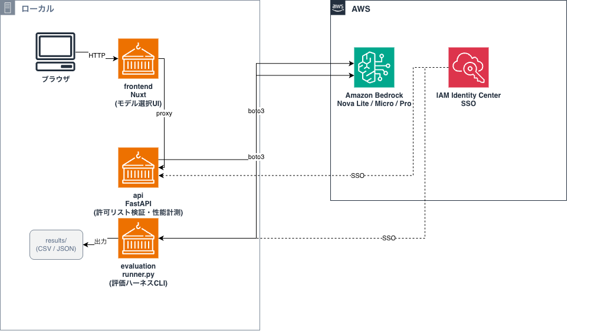
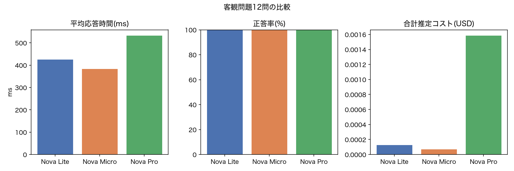
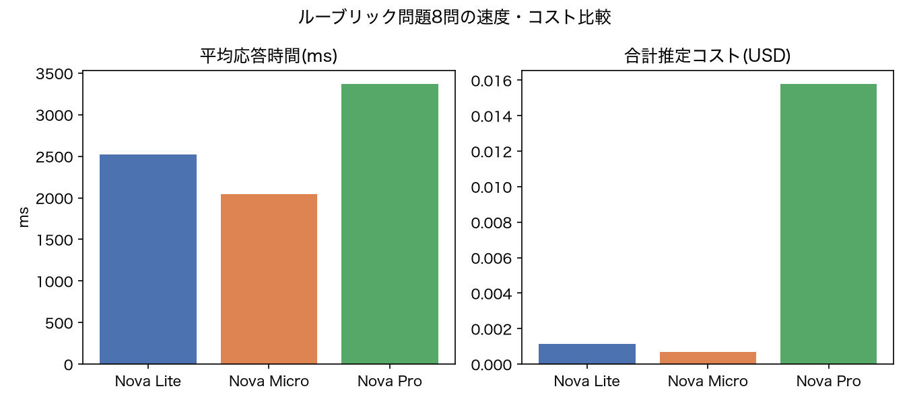
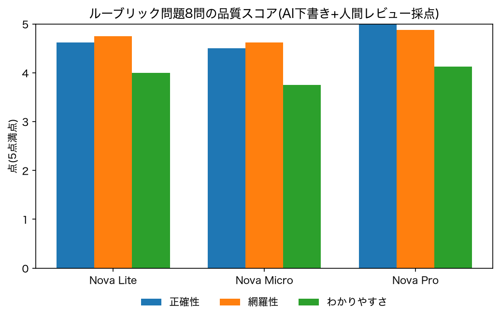

# Amazon Bedrockで複数LLMモデルを比較する評価ハーネスを作ってみた（第2弾）

[前回](https://qiita.com/miyamiya21/items/6759a98d12cdfc884047)はDocker上のFastAPI＋NuxtからAmazon Bedrockを呼んで、最小構成のチャットアプリを作りました。今回はその続きとして、複数のBedrockモデルを選んで比較できるようにし、応答速度・推定コスト・回答品質を実際に計測する「評価ハーネス」を作りました。リポジトリはこちらです。

https://github.com/suupimadev/bedrock-rag-engineering

やったことは大きく3つです。(1) フロントエンドでモデルを選べるようにする、(2) Bedrock呼び出し時間と推定コストを分離して計測する、(3) 複数モデル×複数質問を自動実行して比較する評価ハーネスを作る。当初は4モデルで比較するつもりだったのですが、実際にやってみたら1モデルだけこのAWSアカウントでアクセスできないことが分かり、最終的にはNova系3モデル（Nova Lite / Nova Micro / Nova Pro）での比較になりました。この経緯も含めて書いていきます。

## 全体の構成



ポイントは、評価ハーネス（`evaluation/runner.py`）がFastAPIのAPIサーバーを経由せず、`api`コンテナと同じ`app/bedrock_client.py`のロジックを使って**直接Bedrockを呼び出している**ことです。チャットアプリとしての利用経路（ブラウザ→Nuxt→FastAPI→Bedrock）とは別に、評価専用のCLI（ローカルPython実行）からもBedrockへ到達できるようにしています。評価結果はローカルの`results/`ディレクトリにCSV/JSONとして保存され、AWSには一切送信しません。

## どんな順番で作ったか

前回に続き、STEPを5つに分けて1つずつ進めました。

### STEP 1: 調査と計画

まず既存のリポジトリを調査し、変更方針を整理してユーザーの確認を得てから着手しました。最初から全STEPを一気に実装せず、計画提示の時点でいったん止める、という進め方です。

### STEP 2: モデル選択機能

バックエンドに許可リスト（allowlist）方式でモデルIDを検証する仕組みを入れ、フロントエンドにモデル選択用のプルダウンを追加しました。

### STEP 3: 性能計測

Bedrock呼び出しそのものにかかった時間（`bedrock_duration_ms`）と、APIハンドラ全体の処理時間（`total_duration_ms`）を分けて計測できるようにし、モデルごとの料金表から概算コストを計算するロジックも追加しました。

### STEP 4: LLM評価ハーネス

複数モデル×複数質問を自動実行し、結果をCSV/JSONで保存する評価ハーネス（`evaluation/runner.py`）を作りました。質問は20問用意し、「正解が1つに決まる客観問題」12問と「正解が1つに決まらないルーブリック問題」8問に分けています。客観問題はキーワード一致で自動採点、ルーブリック問題は正確性・網羅性・わかりやすさの3軸・5段階で評価する基準（`datasets/rubric.md`）を作り、人間が読んで採点する前提にしました。

### STEP 5: 自動テスト整備

最後に自動テストを整えました。バックエンド45件・フロントエンド10件・Dockerのスモークテストで、起動確認やAPI疎通確認に加えて「AWS認証情報がフロントエンドに一切渡っていないこと」も自動で確認するようにしています。

## 変更・追加した主なファイル

| ファイル | 役割 |
|---|---|
| `app/models.py` | 許可するモデルの一覧（allowlist） |
| `app/pricing.py` | モデルごとの料金表と概算コスト計算 |
| `app/bedrock_client.py` | Bedrock呼び出し時間の計測・コスト計算 |
| `datasets/questions.json` | 評価用質問20問（客観問題12 + ルーブリック問題8） |
| `datasets/rubric.md` | ルーブリック問題の人手採点基準 |
| `evaluation/scoring.py` | 客観問題の自動採点ロジック |
| `evaluation/runner.py` | 評価ハーネス本体（モック/本番切り替え、ハードリミット、CSV/JSON出力） |
| `frontend/app/components/ModelSelector.vue` | モデル選択UI |
| `tests/test_bedrock_client.py` | Bedrockエラーコード振り分けロジックの単体テスト |
| `frontend/app/app.test.ts` | モデル取得・送信失敗時のエラー表示テスト |
| `scripts/docker-smoke-test.sh` | Docker起動・API疎通・認証情報漏洩チェックのスモークテスト |

## 実装で特に書いておきたいところ

### モデルの許可リスト方式

```python
ALLOWED_MODEL_IDS = frozenset(model.id for model in AVAILABLE_MODELS)

def is_model_allowed(model_id: str) -> bool:
    return model_id in ALLOWED_MODEL_IDS
```

ブロックリスト（「これはダメ」を列挙する方式）ではなく許可リスト（「これだけOK」を列挙する方式）にしています。未知のモデルIDやtypoを安全側に倒して拒否できるのと、意図しないモデルを誤って呼んでコストが発生する事故を防げるのが利点です。

### コスト計算は「実測コスト」と「概算コスト」を区別する

```python
def estimate_cost_usd(model_id: str, input_tokens: int, output_tokens: int) -> Optional[float]:
    pricing = PRICING_TABLE.get(model_id)
    if pricing is None:
        return None  # 料金表にないモデルは「0円」ではなく「計算不能」として区別
    ...
```

料金表にないモデルの場合に`0`ではなく`None`を返しているのがポイントです。「計算できていない」と「本当に0円」を区別しないと、コスト集計で静かに間違った数字が混ざり込んでしまいます。なお、ここで計算しているのはあくまでサードパーティの単価情報をもとにした**推定コスト**であり、AWSからの実際の請求額とは異なります。

### 評価ハーネスはモック/本番を切り替えられる

```python
call_fn: CallFn = live_bedrock_call if args.live else mock_bedrock_call
records = run_evaluation(questions, args.repeats, args.temperature, call_fn, models=models)
```

`--live`を付けない限り、Bedrockには一切接続せずダミー応答でハーネス自体の動作確認ができます。実際にBedrockへ送るときだけ`--live`を付け、その場合も呼び出し回数の見積もりを表示してから`yes`の手入力を要求するようにしています。評価は「何回×何モデル」で簡単に数十〜数百回のAPI呼び出しになり得るので、誤操作でコストが膨らまないようにするための安全策です。

## 検証条件

- 使用モデル: Nova Lite / Nova Micro / Nova Pro（Claude Haiku 5.5はこのAWSアカウントでアクセス権がなく除外。詳細は後述）
- 呼び出し方法: Nova Liteは`amazon.nova-lite-v1:0`（東京リージョンのモデルを直接呼び出し）、Nova MicroとNova Proは`apac.`で始まるクロスリージョン推論プロファイル経由（APACの複数リージョンに振り分けられる）。開発時点で利用可能なIDをそのまま使ったため、**呼び出し経路がモデルによって揃っていない**。応答時間の差には、モデル自体の速さだけでなく経路の違いも含まれている可能性がある
- 計測場所: 東京のローカルPC（Mac）からインターネット経由で呼び出し
- Temperature: 0.2（低めに固定し、モデル間で条件を揃えた）
- 客観問題: 最大出力トークン256、1回ずつ実行（計48回）
- ルーブリック問題: 最大出力トークン1024（後述の理由により256→512→1024と調整）、1回ずつ実行（計24回）

## 動かして確認できたこと

ここに書くのは実際に計測が取れた数字だけです。

なお、ハーネスでは本来P95（遅い方から5%の位置の応答時間）を集計していますが、今回は1モデルあたり12件・8件とサンプルが少なく、計算上のP95が最も遅かった1件とまったく同じ値になりました。そのため表では正直に「最大応答時間」と表記しています。P95として意味のある数字を出すには、`--repeats`を増やすなどして件数を稼ぐ必要があります。

### 客観問題12問の比較

| モデル | 平均応答時間 | 最大応答時間 | 正答率 | 合計推定コスト |
|---|---|---|---|---|
| Nova Lite | 425.4ms | 1088.9ms | 100%（12/12） | $0.000126 |
| Nova Micro | 382.8ms | 708.8ms | 100%（12/12） | $0.0000694 |
| Nova Pro | 531.8ms | 954.7ms | 100%（12/12） | $0.00158 |



3モデルとも正答率は100%で並び、差が出たのは応答時間とコストでした。応答時間はNova Microが最速、コストはNova Proが突出して高い結果です。この程度の簡単な客観問題であれば、最も安いNova Microで十分ということになります。ただし検証条件に書いた通り、Nova Liteだけ呼び出し経路が違うため、Nova Liteとほかの2モデルの応答時間の差は割り引いて見てください。

なお、最初の集計ではNova Microだけ「2問不正解（83.3%）」と出ていました。これは採点ロジックの取りこぼしで、モデルの回答自体は正解でした（詳しくは後述の「ハマったこと」に書いています）。上の表は採点ロジックを直したあと、保存済みの回答を再採点した結果です。

### ルーブリック問題8問の比較

| モデル | 平均応答時間 | 最大応答時間 | 合計推定コスト | 正確性 | 網羅性 | わかりやすさ |
|---|---|---|---|---|---|---|
| Nova Lite | 2519.4ms | 3816.8ms | $0.00113 | 4.63 | 4.75 | 4.0 |
| Nova Micro | 2048.1ms | 2558.8ms | $0.000693 | 4.5 | 4.63 | 3.75 |
| Nova Pro | 3366.3ms | 4402.8ms | $0.0158 | 5.0 | 4.88 | 4.13 |





Nova Proが正確性・網羅性・わかりやすさの全軸で最も高いスコアでしたが、応答時間とコストもその分高くなっています。Nova Microは「わかりやすさ」が他の2モデルより明確に低くなりました。一番大きく点を落としたのは「量子コンピュータの仕組みを高校生にもわかるように説明して」という質問で、量子もつれ（Entanglement）を「エントロピー」と呼ぶ用語の取り違えがあり（正確性3点）、さらに高校生向けという指定に対して`α|0⟩ + β|1⟩`のような数式表記をそのまま使っていました（わかりやすさ2点）。同じ質問に対してNova LiteやNova Proは、コインの裏表のたとえや「もつれ」という正しい訳語を使って説明しており、差がはっきり出た問題でした。

品質スコアの採点方法については正直に書いておきます。当初は「人間が読んで採点する」設計にしていましたが、実際にやってみると24件（8問×3モデル）を1人で読んで採点するのは想像以上に大変でした。最終的には次のような分担になっています。

- 4件（1問目の3モデル分と、2問目のNova Lite分）: 筆者が自分で読んで採点
- 残り20件: AIアシスタント（Claude）が`datasets/rubric.md`の基準で下書きを作り、筆者が確認して**修正なしで採用**

つまり品質スコアの大部分は、実質的にAIが付けた点数を人間が追認したものです。完全な人手採点とは言えず、AIの採点バイアスがそのまま残っている可能性がある点は割り引いて見てください。ちなみに筆者が自分で採点した4件は、同じ回答に対するAIの点数より全体的に厳しめでした（例: 1問目のNova Liteを、AIは正確性5点としたのに対し筆者は4点）。

## セキュリティ面で気をつけたこと

前回から引き続き、長期アクセスキーは使わずIAM Identity Center（SSO）の一時的なSTS認証情報のみで動かしています。今回追加した評価ハーネスも、FastAPIの`api`コンテナと同じ認証情報の渡し方を踏襲しており、`frontend`コンテナにAWS関連の環境変数が渡っていないことは`scripts/docker-smoke-test.sh`で自動確認しています。

評価の実行回数・最大トークン数・同時実行数にはそれぞれハードリミットを設け（質問数30問、繰り返し3回、出力トークン1024、常に逐次実行で並列化しない）、誤操作による想定外のコスト発生を防ぐようにしました。

今回新たに`@vue/test-utils`を追加したことで、`npm audit`に中程度の脆弱性が1系統増えています（`js-beautify`経由の`glob`/`minimatch`）。これは`devDependencies`であり本番ビルド（`.output/`）には含まれないため、本番環境への実害はないと判断しています。前回から持ち越している`node-forge`の件（Nuxtのメジャーバージョンアップ待ち）とあわせて、READMEの「既知の課題」に明記しています。

## やってみて分かったこと、ハマったこと

### 自動採点が正解を「不正解」と判定していた

一番の学びはこれでした。最初の集計ではNova Microだけ12問中2問が不正解で、「安いモデルは精度が落ちるのかな」と考察を書きかけていました。ところが記事を見直す段階で、不正解とされた回答の中身を実際に確認してみると、こうなっていました。

```
obj-04（水の化学式）: 水の化学式は \( \text{H}_2\text{O} \) です。
obj-12（1キロバイト）: 1キロバイトは1,000バイトです。
```

どちらも内容は正解です。1つ目はLaTeX記法で書かれていたため、2つ目は桁区切りのカンマが入っていたため、期待キーワードの`H2O`や`1000`と文字列として一致しなかっただけでした。

採点ロジック（`evaluation/scoring.py`）の正規化処理に、LaTeX記法・Markdownの強調（`**100**`）・桁区切りカンマを取り除く処理を追加し、この2件の実際の回答をそのままテストケースにしています。

```python
_LATEX_TEXT_PATTERN = re.compile(r"\\text\{([^}]*)\}")
_NOISE_CHARS = ("\\(", "\\)", "$", "_", "{", "}", ",", "，", "*", "`")

def normalize_text(text: str) -> str:
    text = _LATEX_TEXT_PATTERN.sub(r"\1", text)
    for noise in _NOISE_CHARS:
        text = text.replace(noise, "")
    return text.strip().lower().replace(" ", "").replace("　", "")
```

回答はCSVに全文保存してあったので、Bedrockを呼び直さずに`python -m evaluation.runner --rescore <CSV>`で再採点でき、追加の課金はゼロで済みました。元の集計結果も別ファイルとして残しています。

あわせて、逆方向の誤判定（間違っているのに正解扱い）がないかも全36件の回答を目視で確認しましたが、こちらは見つかりませんでした。

この件で身にしみたのは、**集計結果の数字だけを見て考察を書くのは危ない**ということです。「Nova Microは精度が落ちる」という結論は、数字の上ではもっともらしく見えましたが、実際は採点する側のバグでした。キーワード一致による自動採点は手軽な反面、LLMが付けてくる装飾（LaTeX・Markdown・説明文）に弱いので、不正解になった回答だけでも中身を目で確認する工程は省かないほうがいいと思います。

### カタログに載っていることとアクセスできることは別物だった

当初4モデル（Nova Lite / Nova Micro / Nova Pro / Claude Haiku 5.5）で比較する予定でしたが、実際に`converse`を呼ぶと最後の1つだけこんなエラーになりました。

```
AccessDeniedException: anthropic.claude-haiku-5-5 is not available for this account.
```

`aws bedrock list-inference-profiles`には普通に出てくるモデルだったので驚きましたが、「一覧に出てくる（カタログに存在する）」ことと「実際に呼び出せる（アクセス権がある）」ことは別物だと分かりました。前回の記事でも似たような学びを書きましたが、今回はさらに踏み込んで「アクセス権がないモデルは比較対象から外す」という判断を実際に下すことになりました。最終的にNova系3モデルのみで比較を進めています。

### 出力トークン上限を使い回したら回答が尻切れになった

ルーブリック問題（「3つ理由と共に説明して」等）を客観問題と同じ256トークン上限で実行したところ、8問×3モデル全24件が文の途中で打ち切られていました。512トークンに上げても一部はまだ打ち切られており、最終的に1024トークンまで上げてようやく全件が自然に完結することを確認しています。客観問題用に決めた上限を、性質がまったく違うルーブリック問題にそのまま流用したのが原因でした。短い質問と長い説明が必要な質問とでは、必要なトークン数の感覚がまったく違うのだと実感しました。

### AWS STS認証情報が作業中に何度も失効した

短期的な認証情報は数時間で失効する仕様のため、作業の節目ごとに`./scripts/refresh-aws-creds.sh`を再実行する必要がありました。前回も似たことを書きましたが、評価ハーネスの実行は時間がかかることがあるため、今回はより頻繁に失効に遭遇しました。

## 改善の考察（今後の課題）

- 客観問題の自動採点はキーワードの部分一致方式で、今回のような表記ゆれは正規化で吸収したが、未知の書き方には引き続き弱い。不正解判定の回答は人間が目視確認する運用を前提にしている
- ルーブリック問題24件のうち20件は、AIの下書きを人間が追認したスコアで、実質的にLLM-as-judgeに近い。人間が自分で採点した4件はAIより厳しめだったので、全件を人間が採点し直すと順位やスコアが変わる可能性がある
- 採点者（レビュー含め）が1名のみで、複数人によるクロスチェックは行っていない
- 各質問の実行は1回のみ（`--repeats 1`）であり、同一条件での再現性（ばらつき）はまだ検証していない

## おわりに

複数のBedrockモデルを実際に比較できる評価ハーネスまでは形になりました。自動採点の結果を鵜呑みにすると誤った結論を書いてしまうこと、モデルカタログに載っていてもアクセスできるとは限らないこと、客観問題とルーブリック問題では必要なトークン数の感覚がまったく違うこと、「人間が採点する」と決めても実際にやってみると規模の見積もりが甘かったことなど、手を動かしてみて初めて分かったことが多い回でした。次はいよいよRAG本体に取り組む予定です。

---

## 今後のRAGロードマップ

[前回記事](https://qiita.com/miyamiya21/items/6759a98d12cdfc884047)の「次にやってみたいこと」のうち、今回で片付いたもの・状況が変わったものを整理しつつ、今後の方向性をまとめます。

### 今回で片付いた、または状況が分かったこと

- Nova Liteと他モデルのレイテンシ比較 → 今回の評価ハーネスで実測済み（上記の比較表）
- Claudeとの比較 → `jp.anthropic.claude-haiku-5-5`は本AWSアカウントでアクセス権がなく（`AccessDeniedException`）、利用目的申請以前の問題だと判明。比較はNova系3モデルに限定した

### 次にやるべきこと（優先度順）

1. **RAGパイプライン本体の実装**（`rag/`配下）: ドキュメント取り込み→埋め込み生成→ベクトル検索→Bedrockでの生成、という一連の流れを作る。ここが本プロジェクトの本題であり、第1弾・第2弾はその前段の基盤づくりだった
2. **評価ハーネスをRAG評価に拡張**: 今回作った`evaluation/runner.py`は「質問と回答」の比較はできるが、RAG特有の「検索結果がどれだけ関連しているか」「生成回答が検索結果に基づいているか（ハルシネーションしていないか）」という指標はまだない
3. **LLM-as-judgeと人手採点の一致度の検証**: 今回わずか4件の比較でもAIの方が甘めに採点する傾向が見えたので、件数を増やしてきちんと測ってみたい
4. **呼び出し経路を揃えた再計測と、複数回実行でのばらつき検証**: 今回はNova Liteだけ直接呼び出しで経路が揃っておらず、`--repeats 1`のためP95も実質最大値だった。経路を揃え、件数を増やして測り直したい
5. **ストリーミング応答**（`converse_stream`）: 体感速度の変化を確認したい
6. **実際のBedrock利用料金をCost Explorerで追跡**: 今回の「推定コスト」が実際の請求額とどれだけ近いかを検証する
7. **Terraformでのインフラ化＋IAM最小権限ポリシーのコード化**: 手作業で確認した最小権限ポリシーを、ドリフト検知できる形でコード化する

### まだ手をつけていないこと（前回から持ち越し）

- 同時リクエスト数を変えたときのスループットやエラー率（今回の評価ハーネスは意図的に逐次実行のみ）
- 複数ターンの会話履歴をBedrockに送った場合の文脈理解の変化
- プロンプトキャッシュによるコスト削減効果
- `npm audit`の`node-forge`脆弱性（Nuxtのメジャーバージョンアップ待ち）

## GitHubでの再現手順

セットアップ手順はREADMEの「セットアップ」〜「Amazon Bedrock連携」節を参照してください。評価ハーネスの使い方はREADME「LLM評価ハーネス」節に詳しく書いていますが、要点だけ抜粋するとこうです。

```bash
# 事前準備（.envの設定、AWS認証情報の発行）が済んでいる前提
source .venv/bin/activate

# 1. まずは無料のモックモードで動作確認（Bedrockへは接続しない）
python -m evaluation.runner --repeats 1

# 2. 実際にBedrockへ送る場合は --live を付ける（課金が発生するため実行前に確認が入る）
python -m evaluation.runner --category objective --repeats 1 --live

# 3. ルーブリック問題（主観評価）は自動採点されないので、採点シートを作って人手で採点する
python -m evaluation.scoring_worksheet results/eval_<タイムスタンプ>_records.csv
python -m evaluation.runner --aggregate-rubric results/eval_<タイムスタンプ>_records.csv

# 4. 採点ロジックを直したときは、保存済みの回答を再採点できる（Bedrockは呼ばない）
python -m evaluation.runner --rescore results/eval_<タイムスタンプ>_records.csv
```

自動テストの実行方法:

```bash
pytest                           # バックエンド（45件）
cd frontend && npm test          # フロントエンド（10件）
./scripts/docker-smoke-test.sh   # Docker起動・疎通・認証情報漏洩チェック（課金なし）
```
